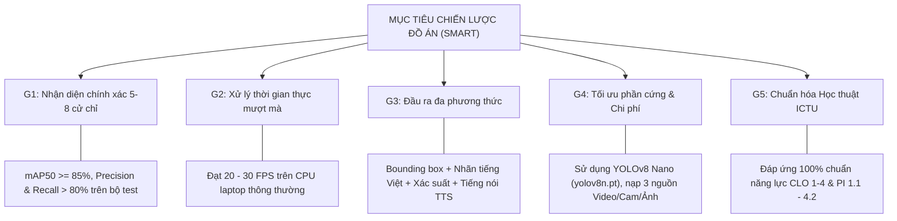
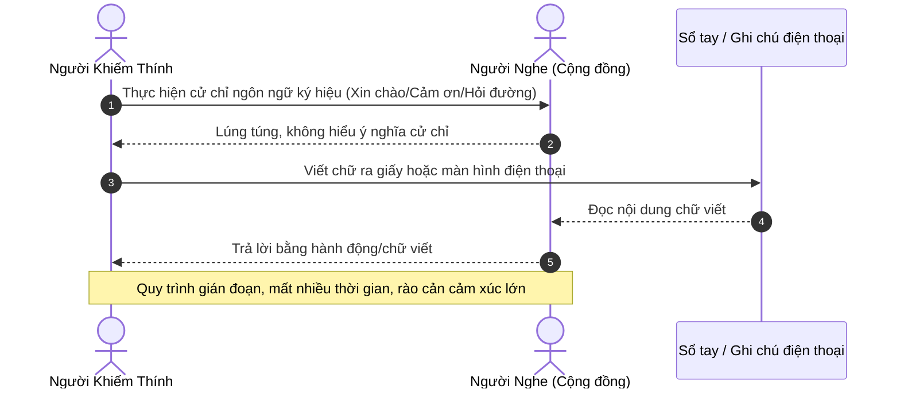
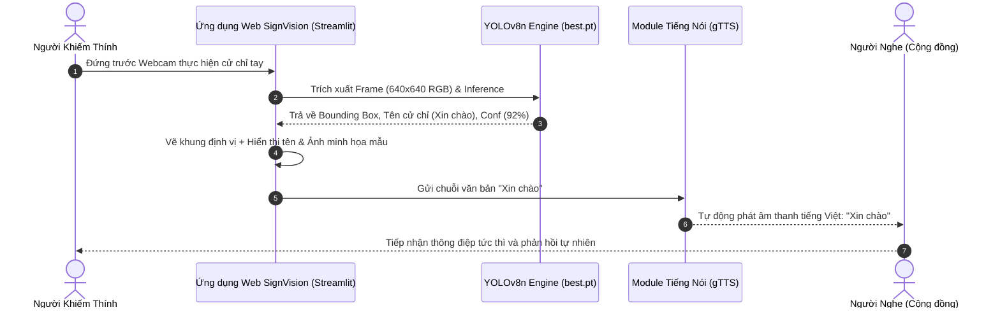
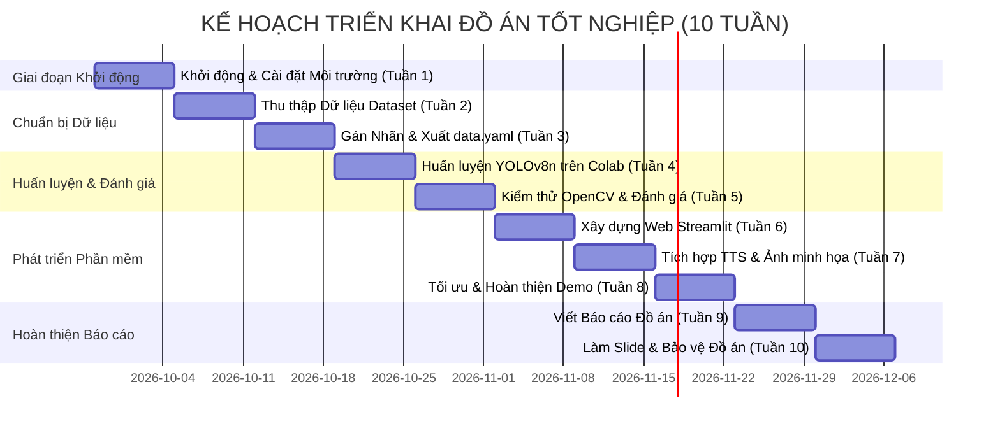

# TÀI LIỆU YÊU CẦU NGHIỆP VỤ CHI TIẾT (BRD)
## Business Requirements Document

* **Tên đề tài:** Xây dựng ứng dụng nhận diện ngôn ngữ ký hiệu dựa trên YOLOv8
* **Mã đề tài / Khóa luận:** Đồ án tốt nghiệp đại học (Khung 10 tuần: 28/09/2026 – 25/12/2026)
* **Sinh viên thực hiện:** Phạm Quang Duy (MSV: DTC235200139 | Lớp: CN CNTT K22A)
* **Giảng viên hướng dẫn:** TS. Quách Xuân Trưởng (Email: qxtruong@ictu.edu.vn)
* **Đơn vị đào tạo:** Bộ môn Đồ án Tốt nghiệp – Khoa Công nghệ Thông tin, Trường Đại học Công nghệ Thông tin & Truyền thông (ICTU)
* **Phiên bản:** v2.0 (Bản mở rộng chi tiết) | **Ngày phát hành:** 16/10/2026

---

## 1. MỤC TIÊU & BỐI CẢNH DỰ ÁN (PROJECT CONTEXT & GOALS)

### 1.1. Bối cảnh bài toán thực tế
Tại Việt Nam, cộng đồng người khiếm thính và khiếm ngôn đối mặt với nhiều trở ngại lớn trong việc hòa nhập cộng đồng, tiếp cận giáo dục, y tế và các dịch vụ công ích. Lý do chính là ngôn ngữ ký hiệu (Sign Language) – phương tiện giao tiếp chính của người khiếm thính – không phổ biến trong cộng đồng người nghe bình thường.

Thực trạng hiện nay:
* **Rào cản ngôn ngữ hai chiều:** Người bình thường đa phần không biết đọc các ký hiệu bàn tay; ngược lại, người khiếm thính gặp khó khăn trong việc truyền đạt mong muốn cấp thiết nếu không có phiên dịch viên hỗ trợ.
* **Chi phí phiên dịch đắt đỏ:** Thuê phiên dịch viên trực tiếp không khả thi cho các tương tác ngắn hằng ngày (mua sắm, hỏi đường, giao tiếp cơ bản).
* **Tiềm năng công nghệ AI/CV:** Sự bùng nổ của các mô hình Thị giác máy tính (Computer Vision) thế hệ mới như YOLOv8 mở ra khả năng tự động hóa việc phát hiện và phiên dịch cử chỉ bàn tay theo thời gian thực (Real-time) trên các thiết bị máy tính cá nhân thông dụng với chi phí bằng $0$.

### 1.2. Mục tiêu chiến lược (SMART Goals)

1. **G1 – Độ chính xác nhận diện vượt trội (mAP50 $\ge 85\%$):**
   * Xây dựng mô hình Học sâu phát hiện đối tượng (Object Detection) dựa trên YOLOv8 Nano (`yolov8n.pt`), nhận diện thành công từ 5 đến 8 cử chỉ ngôn ngữ ký hiệu thông dụng tại Việt Nam (Xin chào, Cảm ơn, Đồng ý, Không, Các số đếm từ 1 đến 5).
2. **G2 – Tốc độ phản hồi thời gian thực (Real-time 20–30 FPS):**
   * Đảm bảo tốc độ trích xuất luồng video và đưa ra dự đoán mượt mà, không bị hiện tượng trễ lag (latency $< 50\text{ms}$ mỗi khung hình) ngay cả khi ứng dụng chạy trên CPU máy tính xách tay cá nhân không có GPU rời.
3. **G3 – Trải nghiệm đa phương thức (Multimodal Output):**
   * Sau khi mô hình nhận diện cử chỉ, ứng dụng lập tức trả về kết quả 4 thành phần đồng thời: Khung định vị (Bounding Box), Nhãn tên tiếng Việt kèm độ tin cậy (Confidence score %), Hình ảnh minh họa mẫu và Phát âm thanh đọc tên ký hiệu bằng giọng nói tiếng Việt tự nhiên qua module Text-to-Speech (TTS).
4. **G4 – Đa dạng nguồn dữ liệu đầu vào (Input Versatility):**
   * Cho phép ứng dụng nhận dữ liệu từ 3 chế độ linh hoạt: Bật trực tiếp Webcam máy tính, Tải lên tệp Video clip MP4/AVI, hoặc Tải lên tệp Hình ảnh tĩnh JPG/PNG.
5. **G5 – Đảm bảo Chuẩn năng lực Đồ án Tốt nghiệp (ICTU Compliance):**
   * Đáp ứng đầy đủ các tiêu chuẩn năng lực CLO 1 đến CLO 4 và bao phủ toàn bộ các yêu cầu chi tiết từ PI 1.1 đến PI 4.2 theo Đề cương ban hành bởi Khoa CNTT – Trường ĐH CNTT & TT (ICTU).

---

## 2. PHẠM VI DỰ ÁN (PROJECT SCOPE)

### 2.1. Trong phạm vi (In-Scope)
* **Xây dựng Bộ dữ liệu (Dataset):**
  * Thu thập từ nguồn Roboflow Universe, Kaggle và tự chụp bổ sung qua Webcam/điện thoại (đạt số lượng 300 – 500 ảnh/cử chỉ).
  * Chuẩn hóa kích thước $640 \times 640$ pixels, gán nhãn khung định vị chuẩn YOLOv8 (`.txt`) và xuất file cấu hình `data.yaml`.
* **Huấn luyện & Đánh giá Mô hình AI:**
  * Huấn luyện mô hình YOLOv8 Nano (`yolov8n.pt`) trên Google Colab GPU (50 epochs).
  * Đánh giá mô hình bằng các độ đo mAP50, Precision, Recall, F1-score và Confusion Matrix.
  * So sánh hiệu năng giữa YOLOv8n với các biến thể/mô hình khác (YOLOv5s, YOLOv8s, Custom CNN).
* **Phát triển Ứng dụng Web Dashboard:**
  * Xây dựng ứng dụng Web bằng Python Streamlit hỗ trợ 3 tab/chế độ đầu vào (Webcam, Video, Hình ảnh).
  * Tích hợp thư viện xử lý ảnh OpenCV và Pillow (PIL).
  * Tích hợp công cụ Chuyển đổi văn bản thành tiếng nói (gTTS hoặc `pyttsx3`) đọc tên cử chỉ tự động.
* **Hồ sơ Đồ án:**
  * Quyển báo cáo thuyết minh 3 Chương (Chương 1: Tổng quan & Cơ sở lý thuyết; Chương 2: Phương pháp & Thiết kế hệ thống; Chương 3: Thực nghiệm & Kết luận).
  * Slide bảo vệ (12–15 trang) và video demo dự phòng.

### 2.2. Ngoài phạm vi (Out-of-Scope)
* Không dịch các câu nói dài phức tạp hoặc cấu trúc ngữ pháp ngôn ngữ ký hiệu nâng cao.
* Không nhận diện bảng chữ cái đầy đủ (29 chữ cái tiếng Việt) trong giai đoạn đồ án này.
* Không kết hợp mô hình nhận diện nét mặt (Facial expression) hay chuyển động toàn thân (Pose estimation).
* Không xây dựng ứng dụng di động native (Android/iOS) hoặc hệ thống phân tán Server-Client phức tạp.

---

## 3. PHÂN TÍCH YÊU CẦU THEO KHUNG NĂNG LỰC (PI MAPPING)

| Mã CLO | Mã PI | Tỷ trọng | Nội dung Yêu cầu Kỹ thuật Đồ án (Chi tiết) |
| :---: | :---: | :---: | :--- |
| **CLO 1** | **PI 1.1** | 5% | **Xác định bài toán & Phạm vi:** Phát hiện và phân loại đối tượng (Object Detection) nhận diện 5-8 cử chỉ tay theo thời gian thực. Đầu vào: Video/Cam/Ảnh. Đầu ra: Bounding Box, tên tiếng Việt, độ tin cậy %, ảnh mẫu và âm thanh giọng nói tiếng Việt. |
| **CLO 1** | **PI 1.2** | 15% | **Thu thập & Chuẩn hóa Yêu cầu Dữ liệu:** Thu thập 300–500 ảnh/cử chỉ từ Roboflow/Kaggle + ảnh tự chụp. Xác định yêu cầu chức năng (nhận diện, phát thanh TTS, giao diện) và phi chức năng (mAP50 $>85\%$, 20-30 FPS). Chuẩn hóa kích thước $640 \times 640$ RGB và định dạng nhãn `.txt` YOLO. |
| **CLO 1** | **PI 1.3** | 10% | **Mô hình hóa bài toán AI/DL:** Xác định Input (Matrix RGB $640 \times 640$), Output ($[x, y, w, h]$, Class ID, Confidence). Ràng buộc: ảnh che khuất $<50\%$, ánh sáng phòng thay đổi. Lựa chọn kiến trúc YOLOv8 Nano phù hợp thiết bị CPU/Webcam laptop. |
| **CLO 1** | **PI 1.4** | 5% | **Đề xuất Tiêu chí Đánh giá:** Thiết lập hệ thống chỉ số đánh giá IoU = 0.5, Accuracy, Precision, Recall, F1-Score và mAP50. |
| **CLO 2** | **PI 2.1** | 15% | **Lựa chọn Mô hình:** Phân tích lý do chọn YOLOv8 Nano (nhẹ, tốc độ tính toán cao, cấu trúc Backbone/Neck/Head tối ưu cho thời gian thực) so với các dòng mô hình khác. |
| **CLO 2** | **PI 2.2** | 25% | **Huấn luyện & Tinh chỉnh Mô hình:** Áp dụng Data Augmentation (xoay ảnh, đổi độ sáng), Fine-tune mô hình trên Google Colab GPU (50 epochs, batch size 16, lr0=0.01) thu được file `best.pt`. |
| **CLO 3** | **PI 3.1** | 5% | **Đánh giá Hiệu năng:** Phân tích kết quả thực nghiệm khách quan qua đồ thị Loss, PR Curve và Confusion Matrix trên tập dữ liệu kiểm thử. |
| **CLO 3** | **PI 3.2** | 10% | **So sánh & Luận giải:** Luận giải sự khác biệt về độ chính xác mAP50 và tốc độ xử lý FPS giữa YOLOv8n, YOLOv5s, YOLOv8s và Custom CNN. |
| **CLO 4** | **PI 4.1** | 5% | **Thiết kế & Triển khai Hệ thống Web:** Tích hợp mô hình `best.pt` vào ứng dụng Web bằng Streamlit, triển khai giao diện người dùng đầy đủ các tính năng nhận diện và phát âm thanh. |
| **CLO 4** | **PI 4.2** | 5% | **Vận hành & Kiểm thử Hoàn thiện:** Đảm bảo hệ thống vận hành mượt mà, ổn định không giật lag, phát tiếng nói chính xác khi phát hiện cử chỉ. |

---

## 4. QUY TRÌNH NGHIỆP VỤ: HIỆN TẠI (AS-IS) VS. TƯƠNG LAI (TO-BE)

### 4.1. Quy trình As-Is (Giao tiếp truyền thống – Rào cản cao)

### 4.2. Quy trình To-Be (Giao tiếp thông minh với Ứng dụng YOLOv8 & TTS)

---

## 5. QUY TẮC NGHIỆP VỤ & RÀNG BUỘC KỸ THUẬT (BUSINESS RULES)

* **BR-RULE-01 (Ngưỡng tin cậy nhận diện):** Ứng dụng chỉ hiển thị khung Bounding Box và phát âm thanh khi xác suất độ tin cậy $Confidence \ge 50\%$ ($0.50$). Mọi dự đoán $< 50\%$ bị coi là nhiễu phông nền và tự động bỏ qua.
* **BR-RULE-02 (Cơ chế tránh lặp âm thanh TTS):** Không phát lại âm thanh tiếng Việt liên tục ở từng khung hình nếu cử chỉ đó đang giữ nguyên vị trí. Module TTS chỉ kích hoạt phát lại nếu phát hiện ký hiệu mới hoặc cử chỉ lặp lại sau khoảng nghỉ $\ge 2$ giây.
* **BR-RULE-03 (Tốc độ xử lý khung hình tối thiểu):** Luồng xử lý video qua OpenCV phải duy trì tốc độ trích xuất khung hình từ 20 FPS trở lên để đảm bảo tính thời gian thực.
* **BR-RULE-04 (Bảo mật & Riêng tư người dùng):** Luồng video từ Webcam chỉ được xử lý tạm thời trên bộ nhớ RAM của máy cục bộ, tuyệt đối không tự động ghi hình hay lưu trữ ảnh cá nhân của người dùng vào đĩa cứng mà không có sự đồng ý.

---

## 6. LỊCH TRÌNH TRIỂN KHAI DỰ ÁN (10 TUẦN - THEO ĐỀ CƯƠNG)

---

## 7. TIÊU CHÍ NGHIỆM THU ĐỒ ÁN (BUSINESS ACCEPTANCE CRITERIA)

Sản phẩm đồ án của sinh viên Phạm Quang Duy được nghiệm thu đạt yêu cầu khi đáp ứng đầy đủ các tiêu chí sau:

1. **AC-1 (Dataset & Labeling):** Bộ dữ liệu đạt tối thiểu 300–500 ảnh/cử chỉ cho 5–8 nhãn ký hiệu, gán nhãn chính xác chuẩn YOLO, phân chia đúng tỷ lệ Train/Val/Test ($70\% / 20\% / 10\%$).
2. **AC-2 (Model Accuracy):** Mô hình `best.pt` đạt độ chính xác mAP50 $\ge 85\%$, Precision $\ge 80\%$, Recall $\ge 80\%$ trên tập dữ liệu kiểm thử độc lập.
3. **AC-3 (Real-time Performance):** Ứng dụng chạy mượt mà đạt $20 - 30\text{ FPS}$ khi bật Webcam trực tiếp trên máy tính laptop thông thường.
4. **AC-4 (Multi-modal Streamlit UI):** 
   * Cho phép chuyển đổi dễ dàng giữa 3 chế độ: Webcam, Video clip, File ảnh.
   * Vẽ đầy đủ Bounding Box, nhãn cử chỉ bằng tiếng Việt, xác suất %.
   * Tự động phát âm thanh đọc đúng tên cử chỉ bằng tiếng Việt qua module TTS.
   * Hiển thị hình ảnh minh họa mẫu để so sánh.
5. **AC-5 (Hồ sơ hoàn chỉnh):** Cung cấp mã nguồn sạch, file trọng lượng `best.pt`, file báo cáo thuyết minh đóng quyển chuẩn định dạng ICTU và Slide bảo vệ sẵn sàng trình bày trước Hội đồng.