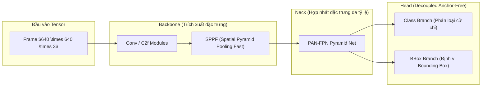
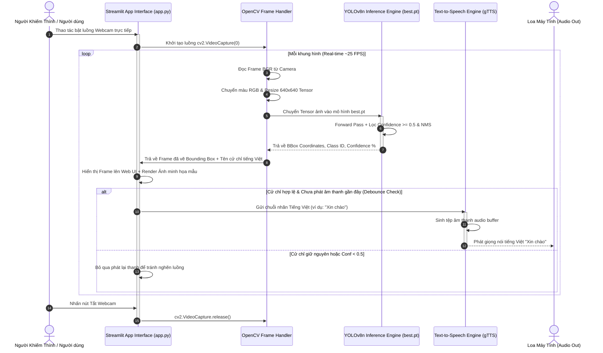

# THIẾT KẾ KIẾN TRÚC HỆ THỐNG CHI TIẾT (SAD)
## System Architecture Document

* **Tên đề tài:** Xây dựng ứng dụng nhận diện ngôn ngữ ký hiệu dựa trên YOLOv8
* **Khóa luận / Đồ án:** Đồ án tốt nghiệp Đại học (Khung 10 tuần: 28/09/2026 – 25/12/2026)
* **Sinh viên thực hiện:** Phạm Quang Duy (MSV: DTC235200139 | Lớp: CN CNTT K22A)
* **Giảng viên hướng dẫn:** TS. Quách Xuân Trưởng
* **Đơn vị đào tạo:** Bộ môn Đồ án Tốt nghiệp – Khoa CNTT, Trường ĐH CNTT & TT (ICTU)
* **Phiên bản:** v2.0 (Bản mở rộng kỹ thuật chi tiết) | **Ngày phát hành:** 16/10/2026

---

## 1. TỔNG QUAN KIẾN TRÚC & PHONG CÁCH THIẾT KẾ

Hệ thống được thiết kế theo mô hình **Kiến trúc Phân tầng 3 Lớp (3-Tier Layered Architecture)** chạy 100% ở môi trường cục bộ (Edge/Local Ecosystem). Kiến trúc này giúp tối ưu hóa thời gian đáp ứng thời gian thực (Real-time latency $< 35\text{ms}$), đảm bảo tính riêng tư dữ liệu và không đòi hỏi hạ tầng máy chủ đám mây đắt đỏ.

```
+-----------------------------------------------------------------------+
|                       PRESENTATION LAYER (GIAO DIỆN)                  |
|                        Streamlit Web Interface (app.py)               |
|   +-------------------+  +-------------------+  +-----------------+   |
|   |  📷 Webcam Stream |  |  🎥 Upload Video  |  | 🖼️ Upload Image |   |
|   +-------------------+  +-------------------+  +-----------------+   |
+-----------------------------------+-----------------------------------+
                                    |
                                    v
+-----------------------------------------------------------------------+
|                       APPLICATION & AI LOGIC LAYER                    |
|   +---------------------------------------------------------------+   |
|   |                 OpenCV Video Processing Engine                |   |
|   |       - Frame Extraction  - Color BGR->RGB  - Resize 640x640  |   |
|   +---------------------------------------------------------------+   |
|   |                 YOLOv8n Neural Network Engine                 |   |
|   |       - Anchor-Free Detection  - NMS Filtering  - Conf >= 0.5 |   |
|   +---------------------------------------------------------------+   |
|   |                 Text-to-Speech (TTS) Audio Engine             |   |
|   |       - gTTS / pyttsx3 Audio Generator  - Audio Debouncer     |   |
|   +---------------------------------------------------------------+   |
+-----------------------------------+-----------------------------------+
                                    |
                                    v
+-----------------------------------------------------------------------+
|                        DATA & RESOURCE LAYER                          |
|   +-------------------+  +-------------------+  +-----------------+   |
|   |  Weights best.pt  |  | Metadata data.yaml|  | Sample Images   |   |
|   +-------------------+  +-------------------+  +-----------------+   |
+-----------------------------------------------------------------------+
```

---

## 2. KIẾN TRÚC MÔ HÌNH HỌC SÂU YOLOV8 NANO (AI CORE DESIGN)

Ứng dụng sử dụng kiến trúc **YOLOv8 Nano (`yolov8n.pt`)** – phiên bản siêu nhẹ được tối ưu hóa riêng cho các thiết bị Edge và CPU laptop thông thường.



### 2.1. Chi tiết cấu trúc các phân tầng YOLOv8
1. **Backbone (Mạng cơ sở CSP-Darknet):** 
   * Trích xuất các đặc trưng từ cấp thấp (đường nét bàn tay, ngón tay) đến cấp cao (hình dáng toàn bộ cử chỉ tay) bằng các khối `C2f` (Cross Stage Partial with 2 convolutions).
   * Khối **SPPF (Spatial Pyramid Pooling Fast)** giúp tăng cường trường tiếp nhận (Receptive field) mà không làm tăng độ trễ tính toán.
2. **Neck (Mạng kết nối PAN-FPN):**
   * Kết hợp mạng Path Aggregation Network (PAN) và Feature Pyramid Network (FPN) để truyền tải thông tin ngữ cảnh từ trên xuống và từ dưới lên, giúp nhận diện hiệu quả bàn tay ở cả khoảng cách gần và xa camera.
3. **Head (Đầu ra Decoupled Anchor-Free):**
   * Sử dụng cơ chế **Anchor-Free** loại bỏ các khung neo cố định, giúp mô hình dự đoán trực tiếp tọa độ tâm và kích thước khung bàn tay.
   * Tách biệt 2 nhánh riêng biệt: Nhánh phân loại ký hiệu (Classification) và Nhánh định vị khung (Bounding Box Regression).

### 2.2. Hàm mất mát & Thuật toán lọc kết quả
* **Hàm mất mát Bounding Box:** Kết hợp **CIoU Loss (Complete IoU)** và **DFL (Distribution Focal Loss)** để tối ưu tọa độ khung định vị bàn tay chuẩn xác:
  $$\mathcal{L}_{box} = \lambda_{CIoU} \cdot \mathcal{L}_{CIoU} + \lambda_{DFL} \cdot \mathcal{L}_{DFL}$$
* **Hàm mất mát phân loại:** Sử dụng **BCE (Binary Cross Entropy) Loss** cho từng lớp cử chỉ.
* **Lọc NMS (Non-Maximum Suppression):** Loại bỏ các khung trùng lặp chồng lấp nhau với ngưỡng IoU $\ge 0.45$, chỉ giữ lại khung có xác suất tin cậy cao nhất.

---

## 3. LUỒNG DỮ LIỆU VẬN HÀNH CHI TIẾT (SEQUENCE DIAGRAM)

Biểu đồ trình tự thể hiện toàn bộ luồng xử lý từ khi người dùng thực hiện cử chỉ trước Webcam cho đến khi ứng dụng phát ra giọng nói Tiếng Việt:



---

## 4. THIẾT KẾ CÁC MODULE THÀNH PHẦN (COMPONENT DESIGN)

### 4.1. Module Giao diện Người dùng (`app.py`)
* **Chức năng:** Xây dựng bằng Streamlit framework, cung cấp bảng điều khiển trực quan.
* **Các thành phần chính:**
  * **Sidebar:** Cho phép chọn 1 trong 3 chế độ hoạt động (Webcam thời gian thực, Upload Video MP4, Upload Ảnh tĩnh JPG/PNG) và tùy chỉnh ngưỡng Confidence Threshold (Default: $0.50$).
  * **Main Display Panel:** Hiển thị luồng video/ảnh kết quả có vẽ khung định vị màu xanh lục và nhãn Tiếng Việt.
  * **Reference Panel:** Cột hiển thị hình ảnh minh họa tư thế tay chuẩn đối chứng.

### 4.2. Module Trích xuất & Tiền xử lý Khung hình (`utils/image_processing.py`)
* **Chức năng:** Sử dụng thư viện `OpenCV` và `Pillow`.
* **Quy trình:**
  $$\text{Raw Frame (BGR)} \xrightarrow{\text{cv2.cvtColor}} \text{RGB Frame} \xrightarrow{\text{cv2.resize}} \text{Tensor (640, 640, 3)} \xrightarrow{\text{Normalize}} \text{Input Tensor}$$

### 4.3. Module Phát Giọng nói Tiếng Việt (`utils/tts_engine.py`)
* **Chức năng:** Chuyển đổi văn bản Tiếng Việt thành âm thanh thoại tự nhiên.
* **Thư viện:** `gTTS` (Google Text-to-Speech) tạo file `.mp3` tạm thời hoặc `pyttsx3` hỗ trợ phát offline không cần kết nối Internet.
* **Thuật toán Chống Lặp Âm Thanh (Audio Debouncer Logic):**
```python
# Pseudo-code logic chống nghẽn âm thanh
last_detected_label = None
last_spoken_time = 0
DEBOUNCE_INTERVAL = 2.0  # giây

def process_audio_feedback(current_label):
    global last_detected_label, last_spoken_time
    current_time = time.time()
    
    if current_label != last_detected_label or (current_time - last_spoken_time) >= DEBOUNCE_INTERVAL:
        speak_vietnamese(current_label)
        last_detected_label = current_label
        last_spoken_time = current_time
```

---

## 5. THIẾT KẾ CẤU TRÚC BỘ DỮ LIỆU & THƯ MỤC NGUỒN

### 5.1. Cấu trúc Cấu hình Dữ liệu (`data.yaml`)
Cơ sở dữ liệu gán nhãn cử chỉ được tổ chức chuẩn hóa theo định dạng của Ultralytics YOLOv8:

```yaml
# Đường dẫn dữ liệu
path: ../data/dataset
train: images/train
val: images/val
test: images/test

# Số lượng lớp nhận diện
nc: 8

# Danh sách tên lớp Tiếng Việt
names:
  0: 'Xin chao'
  1: 'Cam on'
  2: 'Dong y'
  3: 'Khong'
  4: 'So 1'
  5: 'So 2'
  6: 'So 3'
  7: 'So 4'
```

### 5.2. Cấu trúc Thư mục Mã nguồn Dự án
```text
sign-language-yolov8/
│
├── data/
│   ├── dataset/               # Bộ dữ liệu ảnh (train/val/test)
│   ├── data.yaml              # File cấu hình cấu trúc nhãn YOLOv8
│   └── sample_images/         # Kho ảnh minh họa cử chỉ chuẩn dùng cho UI
│
├── models/
│   ├── yolov8n.pt             # Trọng số pre-trained ban đầu từ Ultralytics
│   └── best.pt                # Trọng số tối ưu nhất thu được sau khi Train 50 epochs
│
├── utils/
│   ├── __init__.py            # Module initializer
│   ├── tts_engine.py          # Xử lý Text-to-Speech (gTTS & Debouncer logic)
│   └── image_processing.py    # Xử lý khung hình OpenCV (Resize, Draw BBox)
│
├── app.py                     # File chính chạy ứng dụng Web Dashboard (Streamlit)
├── train.py                   # Script huấn luyện Fine-tune YOLOv8 trên Google Colab GPU
├── requirements.txt           # Danh sách thư viện phụ thuộc (ultralytics, streamlit, gTTS...)
└── README.md                  # Hướng dẫn chi tiết cài đặt và vận hành
```

---

## 6. ĐÁNH GIÁ HIỆU NĂNG & KẾ HOẠCH TRIỂN KHAI (10 TUẦN)

### 6.1. Tiêu chuẩn Đánh giá Phần cứng & Tốc độ Xử lý
* **Môi trường chạy:** CPU máy tính cá nhân Intel Core i5 / AMD Ryzen 5, RAM 8GB (Không bắt buộc GPU rời).
* **Độ trễ hệ thống (Total Latency Breakdown):**
  * Frame Capture & Preprocessing (OpenCV): $\sim 5\text{ms}$
  * YOLOv8n Inference Time: $\sim 25\text{ms}$
  * UI Rendering & Audio Trigger: $\sim 5\text{ms}$
  * **Tổng thời gian xử lý 1 khung hình:** $\sim 35\text{ms}$ $\rightarrow$ Đáp ứng tốc độ mượt mà **$25 - 28\text{ FPS}$**.

### 6.2. Tiến độ Thực hiện Đồ án 10 Tuần (Bám sát Đề cương)

| Tuần | Công việc chi tiết | Sản phẩm đầu ra (Deliverables) |
| :---: | :--- | :--- |
| **Tuần 1** | Khởi động dự án, cài đặt môi trường Anaconda/VS Code, chạy thử YOLOv8 Ultralytics demo. | Môi trường Python sẵn sàng, danh sách 5-8 cử chỉ bàn tay cơ bản được phê duyệt. |
| **Tuần 2** | Thu thập bộ dữ liệu từ Roboflow/Kaggle + Tự chụp 30-50 ảnh/cử chỉ qua Webcam. | Bộ dữ liệu thô 300-500 ảnh/cử chỉ. |
| **Tuần 3** | Gán nhãn Bounding Box trên Roboflow, xuất tập dữ liệu chuẩn YOLOv8. | Tập dữ liệu `data.yaml` chuẩn hóa (70% Train, 20% Val, 10% Test). |
| **Tuần 4** | Huấn luyện Fine-tune mô hình `yolov8n.pt` trên Google Colab GPU (50 epochs, batch size 16). | File trọng lượng mô hình tối ưu `best.pt` và các biểu đồ Loss/mAP. |
| **Tuần 5** | Viết script Python OpenCV kiểm thử mô hình qua Webcam, đánh giá Confusion Matrix. | Báo cáo đánh giá các chỉ số mAP50 $> 85\%$, Precision, Recall. |
| **Tuần 6** | Phát triển giao diện Web bằng Streamlit, dựng 3 chế độ (Webcam, Video, Ảnh). | Ứng dụng Web hiển thị luồng nhận diện và Bounding Box cơ bản. |
| **Tuần 7** | Tích hợp module Chuyển đổi văn bản thành tiếng nói (gTTS/pyttsx3) và Khung ảnh minh họa. | Hoàn thiện tính năng đa phương thức (Chữ + Âm thanh + Ảnh mẫu đối chứng). |
| **Tuần 8** | Kiểm thử toàn hệ thống, tối ưu FPS, sửa lỗi giao diện và quay video Demo dự phòng. | Phần mềm chạy ổn định $20-30\text{ FPS}$, video demo hoàn chỉnh. |
| **Tuần 9** | Viết quyển báo cáo thuyết minh đồ án 3 chương theo quy định nhà trường. | Quyển báo cáo đồ án đóng tập hoàn chỉnh chuẩn định dạng ICTU. |
| **Tuần 10** | Thiết kế Slide thuyết trình (12-15 trang), luyện tập bảo vệ thử trước GVHD. | Slide thuyết trình hoàn chỉnh, sẵn sàng bảo vệ trước Hội đồng. |