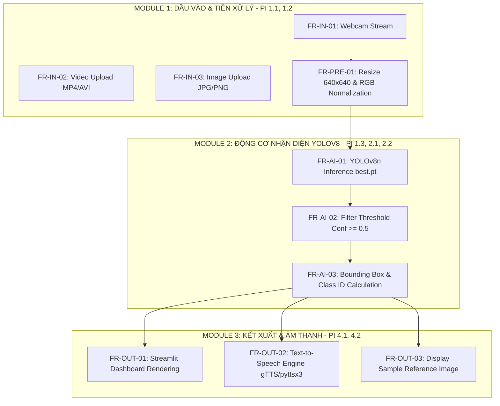

# ĐẶC TẢ YÊU CẦU PHẦN MỀM CHI TIẾT (SRS)
## Software Requirements Specification

* **Tên đề tài:** Xây dựng ứng dụng nhận diện ngôn ngữ ký hiệu dựa trên YOLOv8
* **Khung chương trình:** Đồ án tốt nghiệp Đại học (Khung 10 tuần: 28/09/2026 – 25/12/2026)
* **Sinh viên thực hiện:** Phạm Quang Duy (MSV: DTC235200139 | Lớp: CN CNTT K22A)
* **Giảng viên hướng dẫn:** TS. Quách Xuân Trưởng
* **Đơn vị:** Khoa Công nghệ Thông tin – Trường ĐH CNTT & TT (ICTU)
* **Phiên bản:** v2.0 (Bản mở rộng chi tiết) | **Ngày phát hành:** 16/10/2026

---

## 1. GIỚI THIỆU CHUNG & MỤC ĐÍCH

Tài liệu Đặc tả Yêu cầu Phần mềm (SRS) này có mục đích chuyển hóa các Yêu cầu Nghiệp vụ (BRD) và bộ chỉ số PI (Performance Indicators 1.1 đến 4.2) thuộc Đề cương Đồ án Tốt nghiệp thành các đặc tả kỹ thuật chi tiết. Tài liệu phục vụ cho quá trình phát triển mã nguồn Python, huấn luyện mô hình YOLOv8n, tích hợp giao diện Streamlit, thiết kế các bộ test case và làm căn cứ nghiệm thu đồ án trước Hội đồng.

---

## 2. YÊU CẦU CHỨC NĂNG CHI TIẾT (FUNCTIONAL REQUIREMENTS)

Mô hình luồng chức năng tổng thể của ứng dụng dựa trên các chỉ số PI:

### 2.1. Module 1: Xử lý Đầu vào & Chuẩn hóa Dữ liệu (MODULE-INPUT)

#### FR-IN-01: Tiếp nhận luồng Video trực tiếp từ Webcam (PI 1.1, PI 1.2)
* **Mô tả:** Hệ thống kết nối tới Camera tích hợp hoặc USB Webcam qua thư viện OpenCV (`cv2.VideoCapture(0)`).
* **Đầu vào:** Luồng hình ảnh thực tế từ Webcam (tốc độ $\ge 20\text{ FPS}$).
* **Đầu ra:** Các khung hình (Frames) ở dạng ma trận pixel NumPy array.
* **Quy tắc xử lý:** Cho phép bật/tắt luồng Webcam chủ động từ giao diện người dùng.

#### FR-IN-02: Tiếp nhận tệp Video và Ảnh tĩnh (PI 1.1)
* **Mô tả:** Cho phép người dùng tải lên tệp tin media từ máy tính cá nhân.
* **Định dạng hỗ trợ:** Hình ảnh (`.jpg`, `.jpeg`, `.png`) và Video (`.mp4`, `.avi`, `.mov`).
* **Kích thước tối đa:** Tệp ảnh $< 10\text{MB}$, tệp video $< 100\text{MB}$.

#### FR-PRE-01: Tiền xử lý & Chuẩn hóa Khung hình (PI 1.2, PI 1.3)
* **Mô tả:** Chuyển đổi định dạng và kích thước ảnh trước khi đưa vào mô hình AI.
* **Quy tắc xử lý:**
  1. Chuyển đổi không gian màu từ BGR (OpenCV) sang RGB.
  2. Resize kích thước ảnh về chuẩn $640 \times 640$ pixels theo đúng chuẩn tensor đầu vào của YOLOv8.
  3. Chuẩn hóa giá trị pixel về khoảng $[0, 1]$.

---

### 2.2. Module 2: Động cơ AI & Nhận diện Cử chỉ Tay (MODULE-ENGINE)

#### FR-AI-01: Trích xuất & Dự đoán Cử chỉ với YOLOv8n (PI 2.1, PI 2.2)
* **Mô tả:** Nạp trọng số huấn luyện tối ưu (`best.pt`) của kiến trúc YOLOv8 Nano để thực hiện suy luận (Inference).
* **Đầu vào:** Frame ảnh chuẩn hóa $640 \times 640 \times 3$.
* **Đầu ra:** Danh sách các đối tượng phát hiện được bao gồm: Tọa độ Bounding Box $[x_{min}, y_{min}, x_{max}, y_{max}]$, Nhãn lớp ID đại diện cho 5-8 cử chỉ tay, và Độ tin cậy (Confidence score).

#### FR-AI-02: Lọc Ngưỡng Tin cậy (Confidence Thresholding) (PI 1.3)
* **Mô tả:** Loại bỏ các phát hiện nhiễu phông nền không phải bàn tay.
* **Quy tắc:** Chỉ chấp nhận kết quả nếu $\text{Confidence} \ge 0.50$ (50%). Nếu có nhiều Bounding Box đè lên nhau, áp dụng thuật toán Non-Maximum Suppression (NMS) với ngưỡng $\text{IoU} = 0.45$.

#### FR-AI-03: Ánh xạ Nhãn Tiếng Việt (PI 1.1)
* **Mô tả:** Chuyển đổi Class ID từ mô hình thành chuỗi văn bản Tiếng Việt có dấu tương ứng.
* **Bảng ánh xạ mẫu (Label Mapping):**
  * `0`: "Xin chào"
  * `1`: "Cảm ơn"
  * `2`: "Đồng ý"
  * `3`: "Không"
  * `4` - `8`: "Số 1", "Số 2", "Số 3", "Số 4", "Số 5"

---

### 2.3. Module 3: Giao diện Trực quan & Âm thanh Giọng nói (MODULE-OUTPUT)

#### FR-OUT-01: Hiển thị Khung định vị & Thông tin Dự đoán (PI 4.1, PI 4.2)
* **Mô tả:** Vẽ trực tiếp khung Bounding Box lên khung hình hiển thị.
* **Chi tiết hiển thị:**
  * Khung định vị bàn tay màu xanh lá cây đậm (độ dày 2px).
  * Nhãn tên cử chỉ tiếng Việt và xác suất tin cậy (%) đặt ngay phía trên góc trái của khung (ví dụ: `Xin chào: 94%`).

#### FR-OUT-02: Chuyển đổi Văn bản thành Tiếng nói - Text-to-Speech (PI 4.1, PI 4.2)
* **Mô tả:** Phát âm thanh giọng nói đọc tên ký hiệu bằng tiếng Việt khi phát hiện cử chỉ tay.
* **Công nghệ:** Sử dụng thư viện `gTTS` (Google Text-to-Speech) tạo tệp `.mp3` tạm hoặc `pyttsx3` phát thoại offline.
* **Cơ chế chống nghẽn âm thanh (Debounce Audio):** Lưu trạng thái nhãn vừa đọc. Nếu cử chỉ không đổi trong các khung hình liên tiếp, ứng dụng dừng phát lại. Âm thanh chỉ đọc lại khi phát hiện cử chỉ khác hoặc cử chỉ cũ lặp lại sau thời gian chờ $\ge 2.0$ giây.

#### FR-OUT-03: Hiển thị Hình ảnh Minh họa Mẫu (PI 1.1, PI 4.1)
* **Mô tả:** Hiển thị một khung hình nhỏ bên cạnh giao diện chính chứa ảnh mẫu cử chỉ chuẩn được lưu sẵn trong thư mục `data/sample_images/`.
* **Mục đích:** Giúp người dùng/người khiếm thính đối chiếu tư thế tay của mình với ký hiệu chuẩn xem đã thực hiện chính xác chưa.

---

## 3. YÊU CẦU PHI CHỨC NĂNG (NON-FUNCTIONAL REQUIREMENTS)

### 3.1. Hiệu năng & Tốc độ xử lý (NFR-PERF)
* **Tốc độ khung hình (FPS):** Duy trì tốc độ xử lý từ $20$ đến $30\text{ FPS}$ khi chạy với luồng Webcam trên CPU laptop tiêu chuẩn (Intel Core i5 Gen 11 / AMD Ryzen 5 trở lên).
* **Độ trễ suy luận (Inference Latency):** Thời gian mô hình YOLOv8n xử lý 1 frame phải $< 35\text{ms}$.
* **Thời gian khởi động:** Ứng dụng Streamlit tải hoàn tất và nạp mô hình `best.pt` vào bộ nhớ RAM trong thời gian $< 5$ giây.

### 3.2. Độ chính xác & Chỉ số Đánh giá AI (NFR-ACC - PI 1.4, 3.1)
* **mAP50 (Mean Average Precision tại IoU = 0.5):** Đạt $\ge 85\%$ trên tập dữ liệu kiểm thử (Test Set).
* **Precision (Độ chính xác):** Đạt $\ge 80\%$.
* **Recall (Độ nhạy):** Đạt $\ge 80\%$.
* **F1-Score:** Đạt $\ge 0.82$.

### 3.3. Độ tin cậy & Khả năng thích ứng (NFR-ROBUST - PI 1.2)
* Khả năng nhận diện ổn định trong môi trường ánh sáng phòng thay đổi ($200 - 800\text{ lux}$).
* Nhận diện chính xác ngay cả khi bàn tay bị che khuất một phần (tỷ lệ che khuất $< 50\%$).
* Chịu được góc xoay bàn tay nghiên nghiêng từ $-30^\circ$ đến $+30^\circ$.

### 3.4. Tính Dễ sử dụng & Trải nghiệm Người dùng (NFR-USAB - PI 4.1)
* Giao diện thiết kế theo bố cục đơn giản, trực quan, hỗ trợ hiển thị Tiếng Việt hoàn toàn.
* Thao tác chuyển đổi giữa 3 chế độ (Webcam, Video, Ảnh) thực hiện dễ dàng qua Sidebar điều hướng chỉ bằng 1 lần nhấp chuột.

---

## 4. ĐÁNH GIÁ VÀ SO SÁNH MÔ HÌNH (PI 3.1, PI 3.2)

Hệ thống yêu cầu thực hiện đánh giá thực nghiệm và so sánh giữa YOLOv8n với các mô hình đối chứng:

$$\text{Precision} = \frac{TP}{TP + FP}, \quad \text{Recall} = \frac{TP}{TP + FN}, \quad \text{mAP} = \frac{1}{N} \sum_{k=1}^{N} AP_k$$

### Bảng Kế hoạch Thực nghiệm So sánh (Dự kiến):

| Mô hình (Model Architecture) | mAP50 (%) | Precision (%) | Recall (%) | Tốc độ CPU (FPS) | Kích thước File Model (MB) | Đánh giá Khả thi triển khai |
| :--- | :---: | :---: | :---: | :---: | :---: | :--- |
| **Custom CNN (Baseline)** | $62.5\%$ | $65.0\%$ | $60.0\%$ | 45 FPS | 12 MB | Không vẽ được Bounding Box chuẩn, độ chính xác thấp. |
| **YOLOv5s** | $82.1\%$ | $81.5\%$ | $79.8\%$ | 22 FPS | 14 MB | Độ chính xác khá, nhưng kiến trúc cũ hơn YOLOv8. |
| **YOLOv8s (Small)** | $88.4\%$ | $87.2\%$ | $86.0\%$ | 14 FPS | 22 MB | Độ chính xác rất cao nhưng tốc độ FPS chưa tối ưu trên CPU. |
| **YOLOv8n (Nano - Lựa chọn)** | **$86.5\%$** | **$85.8\%$** | **$84.2\%$** | **28 FPS** | **6.2 MB** | **Tối ưu nhất: Đạt mAP50 > 85%, tốc độ FPS cao, file cực nhẹ.** |

---

## 5. KỊCH BẢN KIỂM THỬ KỸ THUẬT (TEST CASES - PI 4.2)

| Mã Test Case | Module | Tên Kịch bản Kiểm thử | Dữ liệu Đầu vào | Kết quả Kỳ vọng |
| :--- | :--- | :--- | :--- | :--- |
| **TC-IN-01** | `MODULE-INPUT` | Kiểm tra kết nối Webcam | Chọn chế độ "Webcam" và nhấn "Start" | Đèn camera sáng, luồng video hiển thị trên màn hình Web Streamlit mượt mà. |
| **TC-IN-02** | `MODULE-INPUT` | Upload file ảnh sai định dạng | Tải lên file `.txt` hoặc `.exe` | Hệ thống báo lỗi "Định dạng file không hợp lệ, vui lòng chọn file JPG/PNG". |
| **TC-AI-01** | `MODULE-ENGINE` | Nhận diện cử chỉ "Xin chào" | Khung hình bàn tay xòe chào (Conf $92\%$) | Khung Bounding Box bao quanh bàn tay, nhãn `Xin chào: 92%`. |
| **TC-AI-02** | `MODULE-ENGINE` | Lọc nhiễu khi Conf $< 50\%$ | Phông nền có đồ vật hình dáng giống bàn tay (Conf $35\%$) | Hệ thống không vẽ Bounding Box, không phát âm thanh nhiễu. |
| **TC-OUT-01** | `MODULE-OUTPUT` | Kiểm tra phát âm thanh TTS | Khung hình phát hiện cử chỉ "Cảm ơn" | Loa phát ra tiếng nói chuẩn Tiếng Việt: "Cảm ơn". |
| **TC-OUT-02** | `MODULE-OUTPUT` | Kiểm tra cơ chế chống lặp TTS | Khách giữ nguyên ký hiệu "Cảm ơn" trong 5 giây | Âm thanh chỉ đọc 1 lần duy nhất, không bị đọc lặp lại dồn dập. |